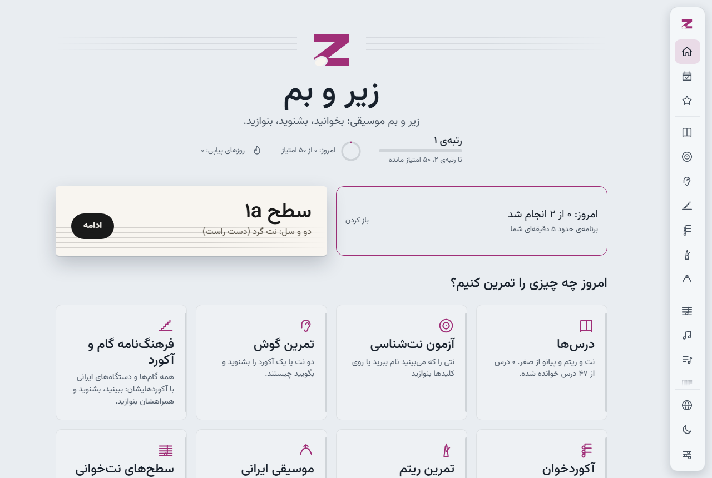
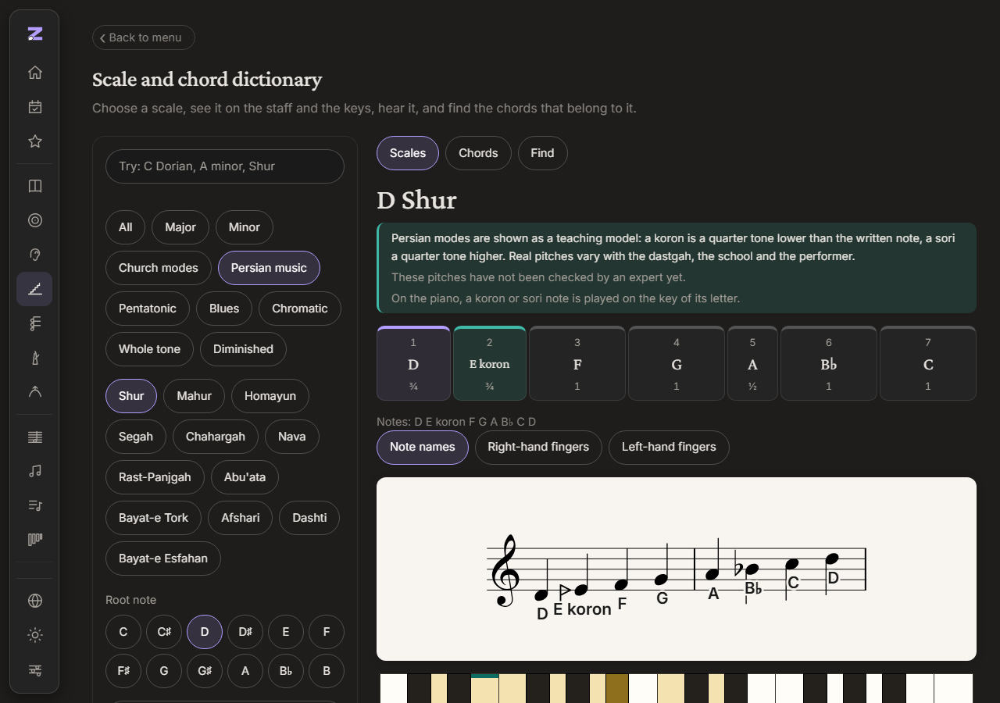
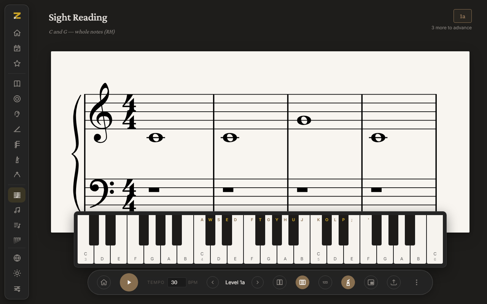
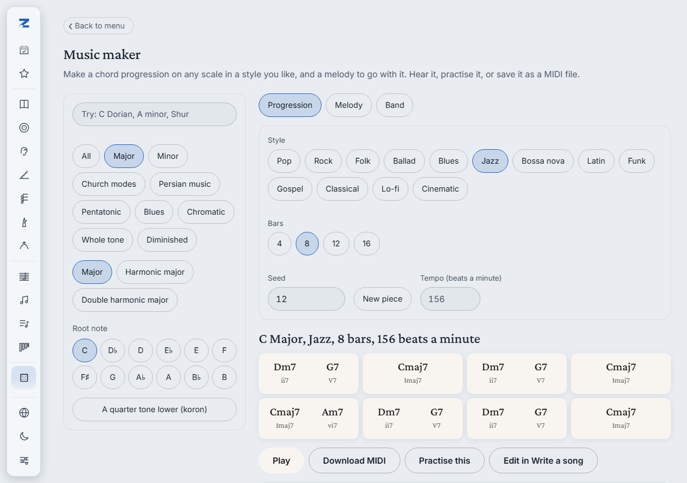
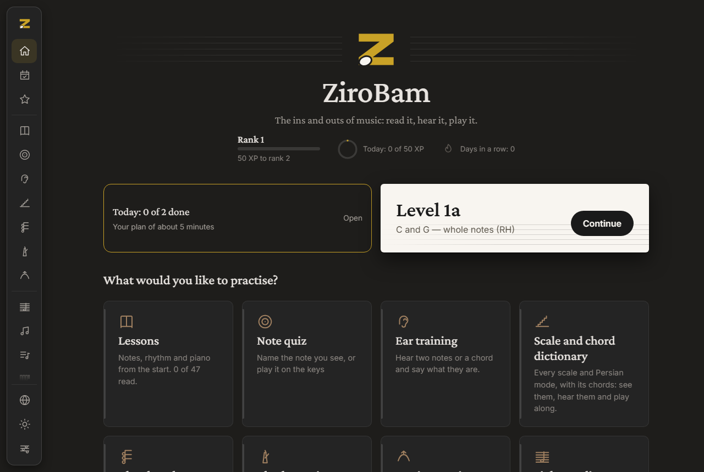
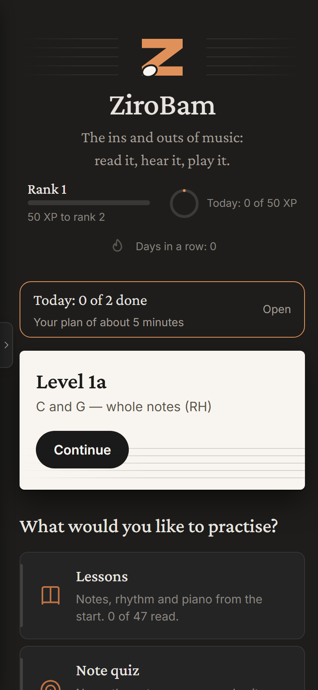
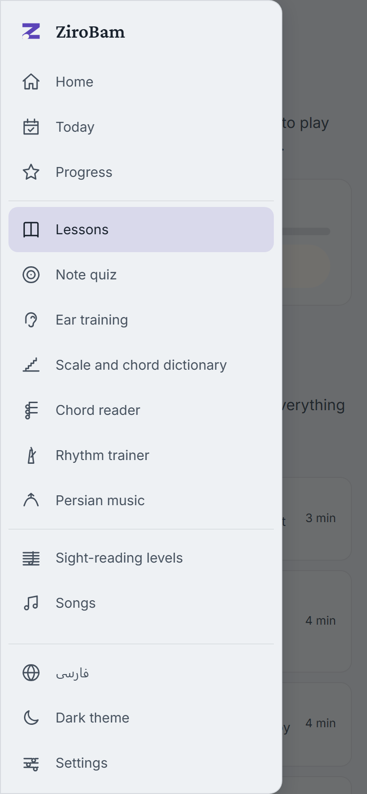

<p align="center">
  
</p>

<h1 align="center">زیر و بم</h1>

<p align="center">
  <b>زیر و بم موسیقی: بخوانید، بشنوید، بنوازید.</b><br>
  مربی رایگان نت‌خوانی و پیانو، به دو زبان فارسی و انگلیسی. بدون اینترنت هم کار می‌کند.
</p>

<p align="center">
  <a href="https://hesamsamani.me/zirobam/"><b>باز کردن برنامه</b></a>
  &nbsp;·&nbsp;
  <a href="README.md">English README</a>
  &nbsp;·&nbsp;
  <a href="#اجرا-روی-رایانه-خودتان">اجرا روی رایانهٔ خودتان</a>
</p>

<p align="center">
  <a href="https://hesamsamani.me/zirobam/"></a>
  <a href="https://github.com/Hesamsamani/zirobam/actions/workflows/pages.yml"></a>
  
  
  
</p>

<p align="center">
  
</p>

**زیر و بم** نت‌خوانی و نواختن پیانو را یاد می‌دهد. حامل را می‌بینید، صدایش را می‌شنوید، آن را با کیبورد MIDI، پیانوی روی صفحه یا صفحه‌کلید رایانه می‌نوازید و همان لحظه پاسخ می‌گیرید. از اولین نت شروع می‌کند و تا ربع‌پردهٔ ایرانی پیش می‌رود.

## چه چیزهایی دارد

| | | |
|---|---|---|
| **خواندن** | سطح‌های نت‌خوانی | بیست سطح، از نت‌های گرد در دو تا ریز و ریزتر در گام‌های گوناگون، دست راست، دست چپ و هر دو، با نت‌هایی که هر بار تازه ساخته می‌شوند |
| | آهنگ‌ها | آهنگ‌های آشنا میزان‌به‌میزان تمرین می‌شوند؛ یا فایل MusicXML یا MIDI خودتان را بیاورید |
| | آزمون نت‌شناسی | «نام نت را پیدا کنید» در پنج مرحله که با پیشرفتتان باز می‌شوند |
| **شنیدن** | تمرین گوش | فاصله‌ها، آکوردها و ملودی‌های کوتاه برای نواختن دوباره، و **ربع‌پردهٔ** کرن و سری |
| | کوک‌سنج | جلوی میکروفون بخوانید یا بنوازید و نت و فاصله‌اش تا کوک را ببینید، همراه با حالت ربع‌پرده |
| **نواختن** | تمرین ریتم | ده سطح ریتم که همراه ضرب‌ها زده می‌شود و تا میلی‌ثانیه سنجیده می‌شود |
| | آکوردخوان | آکوردی بزنید و نامش را ببینید، یا نامی ببینید و آکورد را بزنید |
| | زایلوفون | یک ردیف از صفحه‌کلید رایانه به زایلوفون تبدیل می‌شود |
| **فهمیدن** | درس‌ها | چهل‌وهفت درس کوتاه دربارهٔ نت، ریتم، کلاویه و موسیقی ایرانی |
| | فرهنگ‌نامهٔ گام و آکورد | سی‌ودو گام و سی‌وهفت آکورد در همهٔ نت‌ها، روی حامل و کلیدها، با انگشت‌گذاری و دستهٔ گیتار، و یک یابنده که از روی نت‌هایی که می‌زنید نام گام را می‌گوید |
| | موسیقی ایرانی | دوازده دستگاه و آواز، با کرن و سری که هم دیده و هم شنیده می‌شوند |
| **ساختن** | سازندهٔ موسیقی | گردش آکورد، ملودی و گروه همراه در سیزده سبک، روی هر گام؛ تمرینش کنید، ویرایشش کنید یا به صورت MIDI بردارید |
| **ادامه دادن** | امروز | برنامهٔ ده‌دقیقه‌ای که از روی اشتباه‌هایتان ساخته می‌شود |
| | پیشرفت | رتبه، هدف روزانه، نشان‌ها و نقشهٔ نت‌هایی که در آن‌ها می‌لغزید |

## ببینیدش

<table>
  <tr>
    <td width="50%"><br><sub><b>فرهنگ‌نامه.</b> شور، با ربع‌پردهٔ آن روی حامل و کلیدها.</sub></td>
    <td width="50%"><br><sub><b>تمرین.</b> حامل، پیانوی روی صفحه و نوار دکمه‌ها.</sub></td>
  </tr>
  <tr>
    <td width="50%"><br><sub><b>سازندهٔ موسیقی.</b> هشت میزان آکورد جاز، در حالت روشن با رنگ آبی.</sub></td>
    <td width="50%"><br><sub><b>دو زبان.</b> همین برنامه به انگلیسی و در حالت تیره.</sub></td>
  </tr>
</table>

<p align="center">
  
  &nbsp;&nbsp;
  
</p>
<p align="center"><sub>روی گوشی منو از لبهٔ صفحه باز می‌شود.</sub></p>

## با حس خوب ساخته شده

- **دو زبان، واقعاً.** فارسی و انگلیسی، با چیدمان راست‌به‌چپ، رقم‌های فارسی و سه شیوهٔ نام‌گذاری نت: حرفی (C D E)، سولفژ لاتین (Do Re Mi) و سولفژ فارسی. حامل و کلیدها همیشه چپ‌به‌راست می‌مانند.
- **تیره، روشن یا مطابق دستگاه.** شش رنگ برجسته، نواری که روی صفحه باز می‌شود، و دکمهٔ سریع تغییر زبان و حالت در هر صفحه.
- **بدون اینترنت.** صدای پیانو، فونت‌ها و همهٔ صفحه‌ها جزو خود برنامه‌اند. مثل هر برنامهٔ دیگری از مرورگر نصبش کنید. وقتی نسخهٔ تازه آماده شد، پیش از عوض‌کردن می‌پرسد.
- **هیچ‌چیز از دستگاه شما بیرون نمی‌رود.** پیشرفت، نت‌ها و تنظیمات در مرورگر شما می‌مانند و یک فایل پشتیبان آن‌ها را به مرورگر دیگر می‌برد. حساب کاربری، ردیابی یا درخواست به سایت دیگر در کار نیست.
- **هر شیوه‌ای برای نواختن.** کیبورد MIDI، پیانوی روی صفحه یا صفحه‌کلید رایانه (بر اساس جای کلید، پس با چیدمان فارسی هم کار می‌کند).

| نوع کلید | کلیدهای صفحه‌کلید رایانه |
|---|---|
| کلیدهای سفید | حروف `A S D F G H J K L` و `;` و `'` (از `C4` تا `F5`) |
| کلیدهای سیاه | حروف `W E T Y U O P` |
| تغییر اکتاو | حرف `Z` برای پایین و `X` برای بالا |

## اجرا روی رایانهٔ خودتان

به [Node.js](https://nodejs.org/) نسخهٔ ۲۰ یا بالاتر نیاز دارید.

```bash
npm ci
npm run dev        # http://localhost:5173/zirobam/
```

| دستور | کارش |
|---|---|
| `npm test` | آزمون‌های واحد (Vitest) |
| `npx playwright test` | آزمون‌های سرتاسری (رایانه، گوشی و گوشی افقی، و یک اجرای بدون اینترنت روی نسخهٔ نهایی) |
| `npm run build` | نسخهٔ نهایی در پوشهٔ `dist/`، همراه با کارگر کار بدون اینترنت |
| `node scripts/readme-shots.mjs` | تصویرهای این صفحه را دوباره می‌گیرد |

در ویندوز، `Start-Trainer.ps1` برنامه را راه می‌اندازد و مرورگر را باز می‌کند (میان‌بر روی دسکتاپ همین را اجرا می‌کند).

با Vite و TypeScript و بدون چارچوب رابط ساخته شده است؛ [Verovio](https://www.verovio.org/) نت‌نگاری را می‌کشد، [Tone.js](https://tonejs.github.io/) صدا را می‌سازد، [tonal](https://github.com/tonaljs/tonal) نظریهٔ موسیقی را می‌داند و [@tonejs/midi](https://github.com/Tonejs/Midi) فایل‌های MIDI را می‌خواند و می‌نویسد. ساختار برنامه در [docs/ARCHITECTURE.md](docs/ARCHITECTURE.md) و راهنمای مشارکت در [CONTRIBUTING.md](CONTRIBUTING.md) آمده است.

## سپاس و مجوز

زیر و بم نرم‌افزار آزاد است با مجوز **GNU Lesser General Public License 3.0** (فایل [LICENSE](LICENSE) را ببینید). این برنامه از برنامهٔ متن‌باز نت‌خوانی [ftrain/sightreading](https://github.com/ftrain/sightreading) ساختهٔ پل فورد (LGPL-3.0) برآمده است؛ تغییرهای بعدی در تاریخچهٔ git هست.

- **صدای پیانو:** پیانوی بزرگ سالامندر، ساخته‌ی الکساندر هولم با مجوز [CC BY 3.0](https://creativecommons.org/licenses/by/3.0/) (از نمونه‌های Tone.js کپی شده؛ فایل `public/samples/salamander/README.md` را ببینید).
- **موتور نت‌نگاری:** [Verovio](https://www.verovio.org/) (LGPL-3.0).
- **کتابخانه‌ها:** Tone.js و tonal و ‎@tonejs/midi (MIT)، JSZip (MIT یا GPL-3.0).
- **فونت‌ها:** Inter و Crimson Pro از راه `@fontsource` و Vazirmatn (مجوز SIL OFL 1.1).
- **نت آهنگ‌ها:** نت آهنگ‌های بدون حق نشر از نت‌های LilyPond در ویکی‌پدیای انگلیسی و آلمانی (CC BY-SA 4.0) و از نسخه‌های ABC سایت The Session خوانده شده است؛ فایل `src/songs/libraryMore.ts` را ببینید. کتابخانهٔ آهنگ‌ها فقط عنوان، هنرمند و سطح را فهرست می‌کند و به نت‌ها پیوند می‌دهد؛ نت آهنگ‌های دارای حق نشر در آن نیست.
- **اصطلاح‌ها و کوک ربع‌پرده‌ها** الگویی آموزشی‌اند و در برنامه پیش‌نویس نشان داده می‌شوند؛ فایل `docs/persian-scales-review.md` را ببینید.
